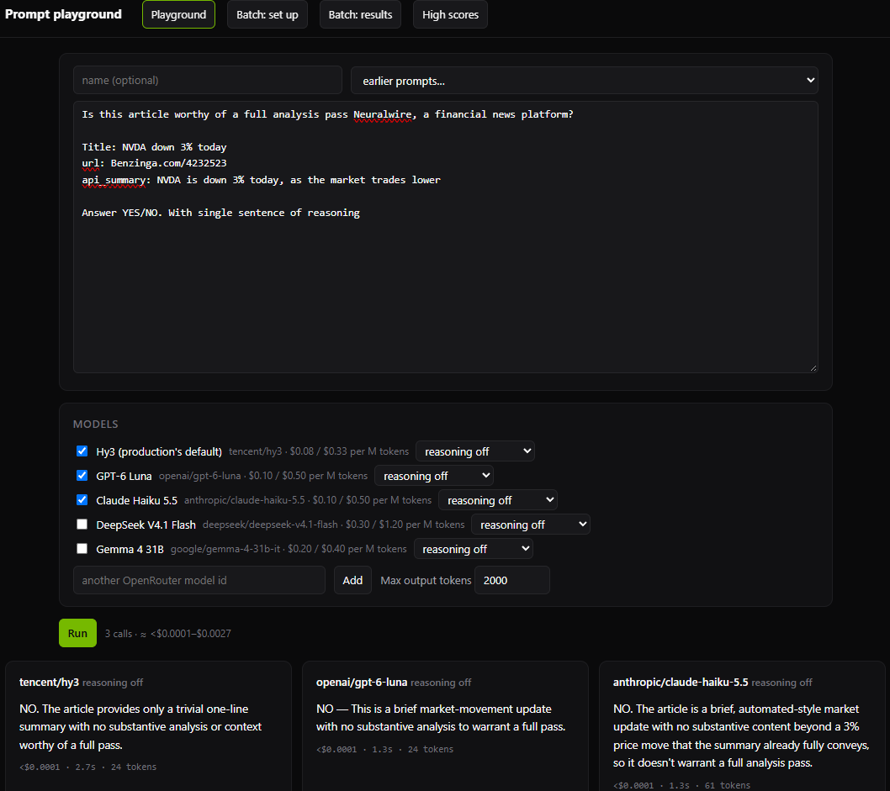
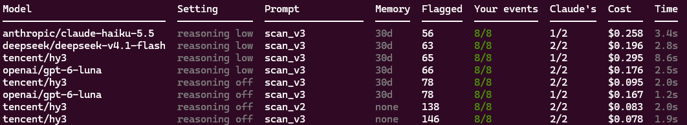

# Prompt & Model playground

A tool for testing prompts and models before they go into NeuralWire. Paste a prompt, tick a few
models, and read their answers side by side. With cost and latency.



## Try it

```bash
make eval        # then open http://localhost:8770
```

`OPENROUTER_KEY` in `python_backend/.env`, needs to be set, since every model runs through OpenRouter.

## Also supports

**A prompt on many cases.** Load a JSONL or CSV file, and each field fills a `{placeholder}` in
the prompt.

**Scoring yes/no prompts.** Mark each case YES or NO once, and every model and prompt you try is
scored against those labels: how many YES cases it caught, how many false alarms, and accuracy.
The tool help you label by showing the cases they disagree on first. Save a score to the high
score list to compare later attempts on the same cases.

**Leaderboards for evals written in code.** NeuralWire's event timeline was tuned this way. Here,
the models rate 500 NVDA articles, to find out which setup flags the fewest articles while still finding every event that belongs on the timeline. `python -m evals leaderboard` prints it:



## Files

| Path | What | In git |
|---|---|---|
| `playground/` | the page, server and model list | yes |
| `runs/playground/` | runs with prompt, models and answers | no |
| `datasets/` | case files with your labels | no (often production data) |
| `highscores.jsonl` | saved scores | yes |
| `.cache/` | every model answer, keyed by the full request | no |

The playground never touches NeuralWire's database.
